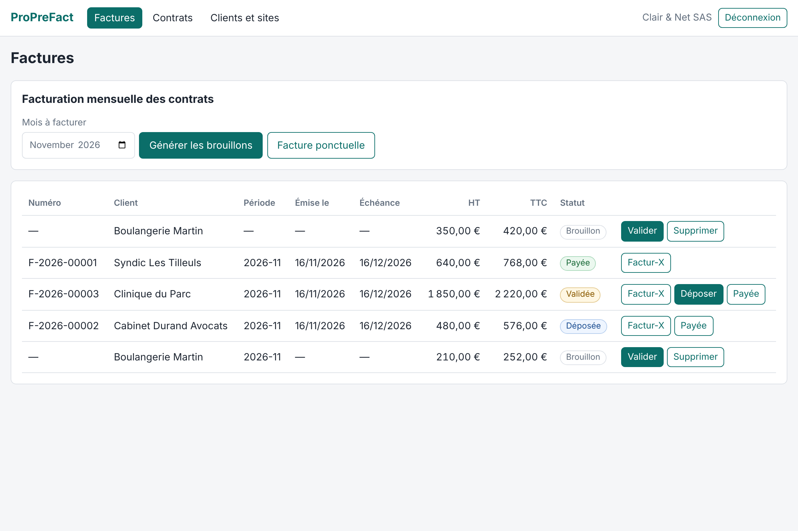

# Directives de correction — ProPreFact

Ce document permet à un développeur ou à un assistant de code, même peu expérimenté, d'appliquer les
corrections issues de la revue de qualité du 13 novembre 2026. Il se suffit à lui-même : tu n'as pas
besoin du rapport de revue.

**Comment t'en servir.** Lis les sections 1 à 4 en entier avant de toucher au code. Ensuite, traite
les lots de la section 5 **dans l'ordre, un seul à la fois**. Ne commence jamais un lot avant que le
précédent soit vérifié et commité.

Chaque lot indique son niveau de confiance :

- **[VÉRIFIÉ]** : le code donné a été exécuté sur ce dépôt et fonctionne. Recopie-le tel quel.
- **[COMPILÉ]** : le code compile sur ce dépôt mais n'a pas pu être exécuté (pas de Docker lors de la
  rédaction). Recopie-le, puis exécute les tests.
- **[À ADAPTER]** : le document donne la cible, les signatures et les étapes, pas tout le code.
  Avance par petites étapes et relance les tests après chacune.

---

## 1. Règles absolues

Ces règles priment sur tout le reste. En cas de doute, arrête-toi et pose la question (section 7).

1. **Un lot = une branche de travail propre = un commit.** Ne mélange jamais deux lots.
2. **Ne modifie jamais un fichier de migration existant** (`V1__` à `V4__` dans
   `backend/src/main/resources/db/migration/`). Flyway compare leur empreinte : les modifier casse
   toutes les bases déjà créées. Tout changement de schéma passe par un **nouveau** fichier
   `V5__…sql`, `V6__…sql`, etc.
3. **Ne supprime, ne désactive et n'affaiblis jamais un test pour le faire passer.** Pas de
   `@Disabled`, pas d'assertion retirée. Si un test échoue, c'est ton changement qui est faux, sauf
   si le lot dit explicitement de modifier ce test.
4. **Ne change pas le comportement visible** en dehors de ce que le lot demande : mêmes URL, mêmes
   noms de champs JSON, mêmes codes HTTP, mêmes messages, sauf indication contraire.
5. **Ne touche pas aux fichiers listés en section 6.**
6. **N'ajoute aucune dépendance** qui n'est pas nommée dans ce document.
7. **Ne mets jamais de secret** (mot de passe, clé, jeton) dans un fichier commité.
8. **Ne déclare jamais un lot terminé sans avoir exécuté sa section « Vérification »** et obtenu
   exactement le résultat attendu. Si tu n'as pas pu exécuter une vérification, écris-le.
9. **Ne pousse pas et n'ouvre pas de demande de fusion** sans qu'on te le demande.
10. Si une étape échoue deux fois de suite après correction, **annule tes changements du lot**
    (`git checkout -- . && git clean -fd` dans le dépôt) et applique la section 7.

---

## 2. Commandes de vérification

Toutes les commandes partent de la racine du dépôt.

### Back-end

```bash
cd backend && mvn -B test          # avant le lot 1
cd backend && ./mvnw -B verify     # à partir du lot 1
```

Résultat attendu au départ : `Tests run: 10, Failures: 0, Errors: 0, Skipped: 0` et `BUILD SUCCESS`.
Le nombre de tests ne doit **jamais diminuer** ; il augmente quand un lot ajoute des tests.

**Piège connu.** Dans certains environnements, Maven échoue avec `Could not find artifact … in
central` ou `PluginResolutionException` alors que l'artefact existe. Ce n'est pas une erreur du
projet. Relance la même commande avec `-U`, jusqu'à quatre fois :

```bash
for i in 1 2 3 4; do ./mvnw -B -U verify && break; done
```

Ne modifie jamais le `pom.xml` pour « réparer » cette erreur.

**Bruit attendu.** Le test `unDepotEnEchecEstRejoueSansDoublon` écrit dans le journal des piles
d'exception `IllegalStateException: Plateforme injoignable`. C'est voulu : seul le résumé
`Tests run:` compte.

### Front-end

```bash
cd frontend && npm ci
cd frontend && npx ng build                 # attendu : « Application bundle generation complete »
cd frontend && npm run format:check         # à partir du lot 1
cd frontend && npm run lint                 # à partir du lot 1
cd frontend && npx ng test --watch=false    # à partir du lot 1
```

### État du dépôt

```bash
git status --short
```

Avant de commiter, vérifie que seuls les fichiers prévus par le lot apparaissent. `backend/target/`,
`frontend/node_modules/` et `frontend/dist/` ne doivent jamais être commités (ils sont ignorés).

---

## 3. Conventions du projet à respecter

### Langue

- **Le vocabulaire du métier est en français, sans accents dans les identifiants** : `Facture`,
  `valider`, `marquerPayee`, `dateEcheance`, `creer`.
- **Les suffixes techniques restent en anglais** : `…Service`, `…Controller`, `…Repository`,
  `…Config`, `…Test`, `…Exception`. Les méthodes Spring Data commencent par `find…`.
- Les commentaires, les messages d'erreur destinés à l'utilisateur et les messages de commit sont en
  français, **avec** accents.
- Conversion vers un DTO : méthode statique nommée `de(...)` (pas `from`, pas `of`).
- Pas de variable d'une lettre dans une méthode de plus de dix lignes. Écris `facture`, `ligne`,
  `vendeur`, pas `f`, `l`, `e`.

### Java

- Java 21, Spring Boot 4.1.2. Indentation de 4 espaces. Le formatage est imposé par Spotless à
  partir du lot 1 : ne formate rien à la main, lance `./mvnw spotless:apply`.
- **Injection par constructeur uniquement.** Jamais `@Autowired` sur un champ (sauf dans les tests).
- Les classes et constructeurs qui n'ont pas besoin d'être publics restent à visibilité de paquet
  (pas de mot-clé `public`), comme dans le code existant.
- Les DTO sont des `record`. Une entité JPA ne doit **jamais** être renvoyée par un contrôleur.
- Les commentaires expliquent **pourquoi**, jamais ce que fait la ligne.
- Argent : toujours `BigDecimal`, arrondi `RoundingMode.HALF_UP` à 2 décimales. Jamais `double`.

### Angular

- Angular 22, composants autonomes, sans `zone.js`. Syntaxe `@if` / `@for` avec `track`.
- Injection avec `inject()`. Membres utilisés par le gabarit en `protected`, dépendances en
  `private readonly`.
- **Tout état affiché par un gabarit est un signal** (`signal`, `computed`).
- Le formatage est imposé par Prettier (`npm run format`).
- TypeScript strict est actif par défaut : n'écris jamais `any` ni `object` comme type de données.

### Messages de commit

Première ligne en français, verbe au présent à la troisième personne, 72 caractères au plus, sans
point final. Corps facultatif qui explique le pourquoi. Exemples existants :

```
Fige les factures validées et conserve le fichier Factur-X émis
Vérifie l'e-mail à l'inscription et limite les tentatives de connexion
```

---

## 4. Ordre des lots et procédure

| Lot | Sujet | Confiance | Dépend de |
|---|---|---|---|
| 1 | Outillage : formatage, analyse, tests front, intégration continue | VÉRIFIÉ | — |
| 2 | Validation des données et erreurs lisibles (back) | VÉRIFIÉ | 1 |
| 3 | Affichage des erreurs de validation (front) | À ADAPTER | 2 |
| 4 | Horloge injectable et dates locales | À ADAPTER | 1 |
| 5 | Tests sur PostgreSQL et profil de test | COMPILÉ | 1 |
| 6 | Course entre requêtes sur le choix du client (front) | À ADAPTER | 1 |
| 7 | Règles métier dans `Facture`, exceptions métier | À ADAPTER | 2, 4 |
| 8 | Services clients et contrats, fin des cycles entre paquets | À ADAPTER | 7 |
| 9 | Duplications, e-mail hors transaction, configuration regroupée | À ADAPTER | 8 |
| 10 | Découpage de `FacturXService` | À ADAPTER | 7 |
| 11 | Migration V5 et compteur de factures | COMPILÉ | 5 |
| 12 | Front : découpage, typage, erreurs centralisées, double clic | À ADAPTER | 3, 6 |
| 13 | Front : écran de connexion, styles, accessibilité, tests | À ADAPTER | 12 |
| 14 | Projet : licences, README, fichiers divers | À ADAPTER | — |

**Procédure pour chaque lot :**

1. `git status --short` doit être vide. Sinon, arrête-toi.
2. Lance les vérifications de la section 2 : tout doit être vert **avant** de commencer.
3. Lis le lot en entier.
4. Applique les étapes dans l'ordre. Après chaque étape qui modifie du code Java, lance
   `./mvnw -B -q test-compile` ; après chaque étape front, `npx ng build`.
5. Lance la section « Vérification » du lot.
6. Relis ton `git diff` ligne par ligne : chaque ligne modifiée doit être justifiée par le lot.
7. Commite avec le message indiqué.
8. Rédige le compte rendu (section 8).

---

## 5. Les lots

### Lot 1 — Outillage [VÉRIFIÉ]

**Pourquoi.** Le projet n'a ni formateur, ni analyse statique, ni intégration continue, et
`npm test` échoue faute de cible. Sans cela, aucun des lots suivants n'est vérifiable
automatiquement.

**Étape 1.1 — Maven Wrapper.** Depuis `backend/` :

```bash
mvn -B -N org.apache.maven.plugins:maven-wrapper-plugin:3.3.4:wrapper -Dmaven=3.9.11
```

Trois fichiers doivent apparaître : `backend/mvnw`, `backend/mvnw.cmd`,
`backend/.mvn/wrapper/maven-wrapper.properties`. Vérifie avec `./mvnw -v`. Commite-les tous.

**Étape 1.2 — Spotless.** Dans `backend/pom.xml`, dans `<build><plugins>`, **juste avant** le plugin
`spring-boot-maven-plugin`, ajoute :

```xml
      <plugin>
        <groupId>com.diffplug.spotless</groupId>
        <artifactId>spotless-maven-plugin</artifactId>
        <version>3.11.0</version>
        <configuration>
          <java>
            <palantirJavaFormat/>
            <removeUnusedImports/>
          </java>
        </configuration>
        <executions>
          <execution>
            <phase>verify</phase>
            <goals>
              <goal>check</goal>
            </goals>
          </execution>
        </executions>
      </plugin>
```

Puis lance `./mvnw -B spotless:apply`. Environ 38 fichiers Java sont reformatés : c'est attendu.
Ne corrige rien d'autre dans ces fichiers.

**Étape 1.3 — Prettier.** Dans `frontend/package.json`, ajoute dans `"scripts"` :

```json
    "format": "prettier --write \"src/**/*.{ts,html,css}\"",
    "format:check": "prettier --check \"src/**/*.{ts,html,css}\"",
```

Puis lance `npm run format`. 16 fichiers sont reformatés : c'est attendu.

**Étape 1.4 — ESLint.** Depuis `frontend/` :

```bash
npx ng add angular-eslint --skip-confirmation
```

La commande crée `eslint.config.js`, ajoute la cible `lint` dans `angular.json` et le script `lint`
dans `package.json`. Lance `npm run lint`. Résultat attendu : `All files pass linting.` Si des
erreurs apparaissent après le formatage, corrige-les une par une sans désactiver de règle.

**Étape 1.5 — Tests front.** Depuis `frontend/` :

```bash
npm install --save-dev vitest jsdom
```

Dans `frontend/angular.json`, dans `projects.frontend.architect`, après la cible `serve`, ajoute :

```json
        "test": {
          "builder": "@angular/build:unit-test"
        }
```

Dans `frontend/package.json`, remplace le script `"test": "ng test"` par
`"test": "ng test --watch=false"`.

Dans `frontend/angular.json`, supprime tout le bloc `"schematics": { … }` (il désactive la création
des fichiers de test pour les nouveaux composants).

Crée `frontend/src/app/modeles.spec.ts` :

```ts
import { messageErreur } from './modeles';

describe('messageErreur', () => {
  it('reprend le détail renvoyé par le serveur', () => {
    expect(messageErreur({ status: 409, error: { detail: 'Facture introuvable' } })).toBe(
      'Facture introuvable',
    );
  });

  it('signale un serveur injoignable', () => {
    expect(messageErreur({ status: 0 })).toBe('Serveur injoignable.');
  });
});
```

Crée `frontend/src/app/session.spec.ts` :

```ts
import { TestBed } from '@angular/core/testing';
import { Session } from './session';

describe('Session', () => {
  beforeEach(() => localStorage.clear());

  it('ouvre puis ferme la session', () => {
    const session = TestBed.inject(Session);
    expect(session.connecte()).toBe(false);
    session.ouvrir({ jeton: 'abc', raisonSociale: 'Net Plus' });
    expect(session.connecte()).toBe(true);
    expect(session.jeton()).toBe('abc');
    session.fermer();
    expect(session.connecte()).toBe(false);
  });
});
```

**Étape 1.6 — Fichiers de racine.** Crée `.editorconfig` à la racine du dépôt :

```ini
root = true

[*]
charset = utf-8
end_of_line = lf
insert_final_newline = true
trim_trailing_whitespace = true
indent_style = space
indent_size = 2

[*.java]
indent_size = 4

[*.md]
trim_trailing_whitespace = false
```

Supprime `frontend/.editorconfig` (remplacé par celui de la racine).

Crée `.gitattributes` à la racine :

```
* text=auto eol=lf
*.ttf binary
*.pdf binary
*.png binary
*.ico binary
mvnw.cmd text eol=crlf
```

**Étape 1.7 — Intégration continue.** Crée `.github/workflows/ci.yml` :

```yaml
name: CI
on:
  push:
    branches: [main]
  pull_request:

jobs:
  backend:
    runs-on: ubuntu-latest
    defaults:
      run:
        working-directory: backend
    steps:
      - uses: actions/checkout@v4
      - uses: actions/setup-java@v4
        with:
          distribution: temurin
          java-version: 21
          cache: maven
      - run: ./mvnw -B verify

  frontend:
    runs-on: ubuntu-latest
    defaults:
      run:
        working-directory: frontend
    steps:
      - uses: actions/checkout@v4
      - uses: actions/setup-node@v4
        with:
          node-version: 22
          cache: npm
          cache-dependency-path: frontend/package-lock.json
      - run: npm ci
      - run: npm run format:check
      - run: npm run lint
      - run: npm test
      - run: npx ng build
```

**Étape 1.8 — README.** Dans `README.md`, section « Tests », remplace le bloc de commande par :

```bash
cd backend && ./mvnw verify
cd frontend && npm run format:check && npm run lint && npm test
```

Dans « Démarrer en développement », remplace `mvn spring-boot:run` par `./mvnw spring-boot:run`, et
dans les prérequis retire « Maven ».

**Vérification.**

```bash
cd backend && ./mvnw -B verify        # 10 tests, BUILD SUCCESS, pas d'erreur spotless
cd frontend && npm run format:check   # « All matched files use Prettier code style! »
cd frontend && npm run lint           # « All files pass linting. »
cd frontend && npm test               # 2 fichiers, 3 tests réussis
cd frontend && npx ng build           # réussi
```

**Commit.** `Ajoute le formatage, l'analyse statique, les tests front et l'intégration continue`

> À partir de ce lot : avant chaque commit, lance `./mvnw spotless:apply` (back) et
> `npm run format` (front).

---

### Lot 2 — Validation des données et erreurs lisibles (back) [VÉRIFIÉ]

**Pourquoi.** Deux défauts confirmés par exécution :

- Un champ trop long (code postal « 75001 CEDEX 08 ») provoque une erreur 500, car aucune
  annotation ne reprend la taille des colonnes.
- Un prix à trois décimales (0,014 × 100) affiche 1,40 € sur le brouillon puis 1,00 € après
  validation, car la base arrondit le prix à 2 décimales.
- Toute erreur de validation renvoie le texte anglais `Invalid request content.`, sans dire quel
  champ est fautif.

**Fichiers.** `backend/src/main/java/com/proprefact/web/Dtos.java`,
`backend/src/main/java/com/proprefact/web/ErreursApi.java`,
`backend/src/test/java/com/proprefact/ParcoursFacturationTest.java`.

**Étape 2.1 — Tailles et décimales.** Dans `Dtos.java`, ajoute les annotations ci-dessous. Chaque
limite est la taille de la colonne dans `V1__schema_initial.sql` : ne les change pas.

| Champ (tous les `record` où il apparaît) | Annotation à ajouter |
|---|---|
| `raisonSociale` | `@Size(max = 200, message = "200 caractères au plus")` |
| `adresse` | `@Size(max = 200, message = "200 caractères au plus")` |
| `codePostal` | `@Size(max = 10, message = "10 caractères au plus")` |
| `ville` | `@Size(max = 100, message = "100 caractères au plus")` |
| `tvaIntra` | `@Size(max = 20, message = "20 caractères au plus")` |
| `email` (tous, y compris `ConnexionReq` et `EmailReq`) | `@Size(max = 200, message = "200 caractères au plus")` |
| `iban` | `@Size(max = 34, message = "34 caractères au plus")` |
| `bic` | `@Size(max = 11, message = "11 caractères au plus")` |
| `SiteReq.nom` | `@Size(max = 200, message = "200 caractères au plus")` |
| `ContratReq.libelle` | `@Size(max = 300, message = "300 caractères au plus")` |
| `LigneReq.designation` | `@Size(max = 500, message = "500 caractères au plus")` |
| `ContratReq.montantMensuelHt`, `LigneReq.prixUnitaireHt` | `@Digits(integer = 10, fraction = 2, message = "2 décimales au plus")` |
| `LigneReq.quantite` | `@Digits(integer = 9, fraction = 3, message = "3 décimales au plus")` |
| `ContratReq.tauxTva`, `LigneReq.tauxTva` | `@Digits(integer = 3, fraction = 2, message = "2 décimales au plus")` et `@DecimalMax(value = "100", message = "100 au plus")` |

Ajoute les imports `jakarta.validation.constraints.Digits` et
`jakarta.validation.constraints.DecimalMax`.

Ajoute aussi un message français aux annotations existantes qui n'en ont pas :

- `@NotBlank` → `@NotBlank(message = "obligatoire")`
- `@NotNull` → `@NotNull(message = "obligatoire")`
- `@NotEmpty` → `@NotEmpty(message = "au moins une ligne")`
- `@Email` → `@Email(message = "adresse e-mail invalide")`
- `@DecimalMin("0.01")` → `@DecimalMin(value = "0.01", message = "doit être supérieur à zéro")`
- `@DecimalMin("0.001")` → `@DecimalMin(value = "0.001", message = "doit être supérieur à zéro")`
- `@DecimalMin("0")` → `@DecimalMin(value = "0", message = "ne peut pas être négatif")`
- `@Size(min = 10, max = 72)` sur `motDePasse` →
  `@Size(min = 10, max = 72, message = "entre 10 et 72 caractères")`

**Étape 2.2 — Gestionnaire d'erreurs.** Remplace tout le contenu de `ErreursApi.java` par :

```java
package com.proprefact.web;

import java.util.LinkedHashMap;
import java.util.Map;
import org.springframework.core.Ordered;
import org.springframework.core.annotation.Order;
import org.springframework.dao.DataIntegrityViolationException;
import org.springframework.dao.OptimisticLockingFailureException;
import org.springframework.http.HttpStatus;
import org.springframework.http.ProblemDetail;
import org.springframework.validation.FieldError;
import org.springframework.web.bind.MethodArgumentNotValidException;
import org.springframework.web.bind.annotation.ExceptionHandler;
import org.springframework.web.bind.annotation.RestControllerAdvice;

/** Traduit les erreurs en réponses lisibles par le front-end (format « problem detail »). */
@RestControllerAdvice
@Order(Ordered.HIGHEST_PRECEDENCE) // doit passer avant le gestionnaire par défaut de Spring
class ErreursApi {

    /** Deux actions simultanées sur le même élément : la seconde est refusée plutôt qu'appliquée à l'aveugle. */
    @ExceptionHandler(OptimisticLockingFailureException.class)
    ProblemDetail modificationConcurrente() {
        return ProblemDetail.forStatusAndDetail(
                HttpStatus.CONFLICT, "Cet élément vient d'être modifié par une autre action : rechargez la page");
    }

    /** Ajoute la propriété « erreurs » : un message par champ fautif. */
    @ExceptionHandler(MethodArgumentNotValidException.class)
    ProblemDetail donneesInvalides(MethodArgumentNotValidException exception) {
        Map<String, String> erreurs = new LinkedHashMap<>();
        for (FieldError erreur : exception.getBindingResult().getFieldErrors()) {
            erreurs.putIfAbsent(erreur.getField(), erreur.getDefaultMessage());
        }
        ProblemDetail probleme = ProblemDetail.forStatusAndDetail(
                HttpStatus.BAD_REQUEST, "Données invalides : vérifiez les champs signalés");
        probleme.setProperty("erreurs", erreurs);
        return probleme;
    }

    /** Filet de sécurité : une contrainte de la base refusée ne doit jamais donner une erreur 500. */
    @ExceptionHandler(DataIntegrityViolationException.class)
    ProblemDetail donneesEnConflit() {
        return ProblemDetail.forStatusAndDetail(
                HttpStatus.CONFLICT, "Enregistrement impossible : ces données sont en conflit avec des données existantes");
    }
}
```

**Piège.** Sans `@Order(Ordered.HIGHEST_PRECEDENCE)`, Spring utilise son propre gestionnaire et le
message reste en anglais. Ne retire pas cette annotation.

**Étape 2.3 — Tests.** Dans `ParcoursFacturationTest.java`, ajoute ce test à la fin de la liste des
tests (avant les méthodes privées utilitaires) :

```java
    @Test
    void lesDonneesInvalidesSontRefuseesChampParChamp() throws Exception {
        String jeton = inscrire("valid@valid.test", "909090909", "Propreté Valide");
        mvc.perform(post("/api/clients")
                        .header("Authorization", "Bearer " + jeton)
                        .contentType(MediaType.APPLICATION_JSON)
                        .content("""
                        {"raisonSociale":"","siren":"12","adresse":"a","codePostal":"75001 CEDEX 08","ville":"Paris"}"""))
                .andExpect(status().isBadRequest())
                .andExpect(jsonPath("$.detail").value("Données invalides : vérifiez les champs signalés"))
                .andExpect(jsonPath("$.erreurs.raisonSociale").value("obligatoire"))
                .andExpect(jsonPath("$.erreurs.siren").value("9 chiffres attendus"))
                .andExpect(jsonPath("$.erreurs.codePostal").value("10 caractères au plus"));

        int client = id(envoyer(post("/api/clients"), jeton, """
                {"raisonSociale":"Client","siren":"123456789","adresse":"a","codePostal":"75001","ville":"Paris"}"""));
        mvc.perform(post("/api/factures")
                        .header("Authorization", "Bearer " + jeton)
                        .contentType(MediaType.APPLICATION_JSON)
                        .content("""
                        {"clientId":%d,"lignes":[{"designation":"d","quantite":100,"prixUnitaireHt":0.014,"tauxTva":20}]}"""
                                .formatted(client)))
                .andExpect(status().isBadRequest())
                .andExpect(jsonPath("$.erreurs['lignes[0].prixUnitaireHt']").value("2 décimales au plus"));
    }
```

Dans `backend/src/test/resources/application.properties`, ajoute la ligne
`spring.mvc.problemdetails.enabled=true` (elle manque par rapport à la configuration de production ;
le lot 5 supprimera cette duplication).

**Vérification.** `./mvnw -B verify` : 11 tests, 0 échec.

**Commit.** `Valide tailles et décimales des données reçues et détaille les erreurs par champ`

---

### Lot 3 — Affichage des erreurs de validation (front) [À ADAPTER]

**Pourquoi.** Le front n'affiche pas les erreurs par champ, et un formulaire invalide laisse
l'utilisateur devant un bouton grisé sans explication.

**Fichiers.** `frontend/src/app/modeles.ts`, `frontend/src/app/modeles.spec.ts`,
`frontend/src/styles.css`.

**Étape 3.1.** Dans `modeles.ts`, remplace la fonction `messageErreur` par :

```ts
const LIBELLES_CHAMP: Record<string, string> = {
  raisonSociale: 'Raison sociale',
  siren: 'SIREN',
  tvaIntra: 'N° de TVA',
  adresse: 'Adresse',
  codePostal: 'Code postal',
  ville: 'Ville',
  email: 'E-mail',
  motDePasse: 'Mot de passe',
  iban: 'IBAN',
  bic: 'BIC',
  nom: 'Nom du site',
  libelle: 'Prestation',
  montantMensuelHt: 'Montant mensuel HT',
  tauxTva: 'TVA',
  dateDebut: 'Début',
  designation: 'Désignation',
  quantite: 'Quantité',
  prixUnitaireHt: 'Prix unitaire HT',
};

interface ErreurHttp {
  status?: number;
  error?: { detail?: string; erreurs?: Record<string, string> };
}

/** Message lisible à partir d'une erreur HTTP du back-end (format « problem detail »). */
export function messageErreur(e: unknown): string {
  const err = e as ErreurHttp;
  const parChamp = Object.entries(err?.error?.erreurs ?? {}).map(([champ, message]) => {
    // « lignes[0].prixUnitaireHt » → « prixUnitaireHt »
    const nom = champ.split('.').pop() ?? champ;
    return `${LIBELLES_CHAMP[nom] ?? nom} : ${message}`;
  });
  if (parChamp.length > 0) return parChamp.join(' — ');
  if (err?.error?.detail) return err.error.detail;
  if (err?.status === 0) return 'Serveur injoignable.';
  if (err?.status === 429) return 'Trop de tentatives : réessayez dans quelques minutes.';
  return 'Une erreur est survenue.';
}
```

**Étape 3.2.** Dans `modeles.spec.ts`, ajoute :

```ts
  it('détaille les erreurs par champ', () => {
    const erreur = {
      status: 400,
      error: { detail: 'Données invalides', erreurs: { siren: '9 chiffres attendus', 'lignes[0].quantite': 'obligatoire' } },
    };
    expect(messageErreur(erreur)).toBe('SIREN : 9 chiffres attendus — Quantité : obligatoire');
  });
```

**Étape 3.3.** Dans `styles.css`, après la règle `input:focus, select:focus`, ajoute :

```css
input.ng-invalid.ng-touched,
select.ng-invalid.ng-touched {
  border-color: var(--alerte);
}
```

**Étape 3.4.** Dans `pages/clients.html`, `pages/contrats.html` et `pages/factures.html`, **juste
avant** chaque `<div class="actions">` qui contient un bouton `type="submit"`, ajoute (en remplaçant
`form` par le nom de la variable de formulaire du bloc : `form` ou `formSite`) :

```html
@if (form.invalid && form.touched) {
  <p class="info">Complétez les champs entourés en rouge pour continuer.</p>
}
```

**Vérification.** `npm run format && npm run lint && npm test && npx ng build` : tout réussi, 4
tests.

**Commit.** `Affiche les erreurs de validation champ par champ`

---

### Lot 4 — Horloge injectable et dates locales [À ADAPTER]

**Pourquoi.** `LocalDate.now()` et `Instant.now()` utilisent l'horloge et le fuseau du serveur. Sur
un serveur en UTC, une facture validée le 1er janvier à 0 h 30 heure de Paris serait datée du
31 décembre et numérotée dans l'année précédente. Côté front, `new Date().toISOString()` donne la
date UTC, donc la veille entre minuit et 1 h ou 2 h.

**Étape 4.1.** Crée `backend/src/main/java/com/proprefact/config/HorlogeConfig.java` :

```java
package com.proprefact.config;

import java.time.Clock;
import java.time.ZoneId;
import org.springframework.context.annotation.Bean;
import org.springframework.context.annotation.Configuration;

@Configuration
class HorlogeConfig {

    /** Les factures sont datées à l'heure légale française, quel que soit le fuseau du serveur. */
    @Bean
    Clock horloge() {
        return Clock.system(ZoneId.of("Europe/Paris"));
    }
}
```

**Étape 4.2.** Injecte `Clock horloge` par le constructeur et remplace les appels, classe par
classe. Recompile après chaque classe.

| Classe | Remplacer | Par |
|---|---|---|
| `FacturationService` (méthode `valider`) | `LocalDate.now()` | `LocalDate.now(horloge)` |
| `FacturationService` (méthode `document`) | `new FactureDocument(f, contenu, sha256(contenu))` | `new FactureDocument(f, contenu, sha256(contenu), horloge.instant())` |
| `FactureDocument` (constructeur public) | paramètre absent, `this.creeLe = Instant.now();` | nouveau paramètre `Instant creeLe`, `this.creeLe = creeLe;` |
| `AuthService` (3 endroits) | `Instant.now()` | `horloge.instant()` |
| `DepotService` (2 endroits) | `Instant.now()` | `horloge.instant()` |
| `LimiteurTentatives` | supprimer le constructeur public sans paramètre | garder le seul constructeur `LimiteurTentatives(Clock horloge)` |
| `RelanceDepots` | `depots.relancer(Instant.now())` | injecter `Clock` et écrire `depots.relancer(horloge.instant())` |

Après ces changements, cette commande ne doit plus rien renvoyer :

```bash
grep -rnE "(Instant|LocalDate|LocalDateTime)\.now\(\)" backend/src/main
```

**Pièges.**

- **Ne touche pas à `FacturXService.date(...)`** ni à son `ZoneId.systemDefault()`. La bibliothèque
  Mustang reformate ces dates avec le fuseau par défaut de la JVM : les deux doivent rester
  cohérents, sinon les dates du XML reculent d'un jour.
- **Ne remplace pas l'horloge par une horloge fixe dans `ParcoursFacturationTest`.** Les jetons de
  connexion y sont vérifiés avec l'heure réelle : une horloge figée dans le passé les ferait tous
  expirer.

**Étape 4.3 — Front.** Dans `frontend/src/app/modeles.ts`, ajoute :

```ts
/** Date du jour dans le fuseau du navigateur, au format AAAA-MM-JJ. */
export function aujourdhui(): string {
  const d = new Date();
  const deuxChiffres = (n: number) => String(n).padStart(2, '0');
  return `${d.getFullYear()}-${deuxChiffres(d.getMonth() + 1)}-${deuxChiffres(d.getDate())}`;
}
```

- Dans `pages/contrats.ts`, remplace `new Date().toISOString().slice(0, 10)` par `aujourdhui()`.
- Dans `pages/factures.ts`, remplace `new Date().toISOString().slice(0, 7)` par
  `aujourdhui().slice(0, 7)`.
- Importe `aujourdhui` depuis `'../modeles'` dans les deux fichiers.

**Vérification.** `./mvnw -B verify` (11 tests) ; front : `npm run lint && npm test && npx ng build`.
La commande `grep` de l'étape 4.2 ne renvoie rien.

**Commit.** `Date les factures à l'heure française avec une horloge injectable`

---

### Lot 5 — Tests sur PostgreSQL et profil de test [COMPILÉ]

**Pourquoi.** Les tests tournent sur H2 alors que la production est sur PostgreSQL, et le fichier
`src/test/resources/application.properties` masque entièrement celui de production : la
configuration réelle n'est jamais testée.

**Prérequis.** Docker doit fonctionner : `docker info` doit afficher une ligne `Server Version`.
**Si ce n'est pas le cas, ne fais pas ce lot** ; signale-le dans ton compte rendu et passe au
lot 6. Le lot 11 devra alors attendre aussi.

**Étape 5.1.** Dans `backend/pom.xml`, **remplace** la dépendance `com.h2database:h2` par :

```xml
    <dependency>
      <groupId>org.springframework.boot</groupId>
      <artifactId>spring-boot-testcontainers</artifactId>
      <scope>test</scope>
    </dependency>
    <dependency>
      <groupId>org.testcontainers</groupId>
      <artifactId>testcontainers-postgresql</artifactId>
      <scope>test</scope>
    </dependency>
```

Ne mets pas de `<version>` : Spring Boot les gère. Attention au nom : c'est
`testcontainers-postgresql` (Testcontainers 2), pas `postgresql`.

**Étape 5.2.** Crée `backend/src/test/java/com/proprefact/BaseDeTest.java` :

```java
package com.proprefact;

import org.springframework.boot.test.context.TestConfiguration;
import org.springframework.boot.testcontainers.service.connection.ServiceConnection;
import org.springframework.context.annotation.Bean;
import org.testcontainers.postgresql.PostgreSQLContainer;

/** Base PostgreSQL jetable, identique à celle de production, démarrée pour les tests d'intégration. */
@TestConfiguration(proxyBeanMethods = false)
public class BaseDeTest {

    @Bean
    @ServiceConnection
    PostgreSQLContainer postgres() {
        return new PostgreSQLContainer("postgres:16");
    }
}
```

Attention à l'import : `org.testcontainers.postgresql.PostgreSQLContainer` (pas
`org.testcontainers.containers…`), et la classe n'a pas de paramètre de type.

**Étape 5.3.** Supprime `backend/src/test/resources/application.properties` et crée à la place
`backend/src/test/resources/application-test.properties`, qui ne contient **que** les écarts :

```properties
app.jwt.secret=secret-de-test-secret-de-test-secret-de-test
# Les tests partagent une seule adresse IP : la limite par IP est neutralisée.
app.auth.max-requetes-par-ip=100000
# La relance est appelée à la main par les tests.
app.depot.relance-active=false
```

**Étape 5.4.** Dans `ParcoursFacturationTest.java`, ajoute sur la classe, sous
`@AutoConfigureMockMvc` :

```java
@ActiveProfiles("test")
@Import(BaseDeTest.class)
```

avec les imports `org.springframework.test.context.ActiveProfiles` et
`org.springframework.context.annotation.Import`.

**Étape 5.5.** Dans `README.md`, section « Tests », ajoute la phrase : « Les tests d'intégration
démarrent une base PostgreSQL jetable : Docker doit être lancé. »

**Vérification.** `./mvnw -B verify` : 11 tests, 0 échec. Le journal doit contenir
`Creating container for image: postgres:16`.

**Si un test échoue sur PostgreSQL alors qu'il passait sur H2**, c'est un vrai défaut que H2
cachait. Ne reviens pas à H2 : applique la section 7 avec le message d'erreur exact.

**Commit.** `Exécute les tests d'intégration sur PostgreSQL avec la configuration réelle`

---

### Lot 6 — Course entre requêtes sur le choix du client (front) [À ADAPTER]

**Pourquoi.** Si l'utilisateur change deux fois de client rapidement et que la première réponse
arrive en dernier, la liste montre les sites du client A alors que le client B est sélectionné.
Dans l'écran des contrats, il crée alors un contrat pour le mauvais client.

**Étape 6.1 — `pages/contrats.ts`.** Ajoute les imports :

```ts
import { takeUntilDestroyed } from '@angular/core/rxjs-interop';
import { Subject, catchError, of, switchMap } from 'rxjs';
```

Ajoute le champ, sous `private readonly api = inject(Api);` :

```ts
  private readonly clientChoisi = new Subject<number>();
```

À la fin du constructeur, ajoute :

```ts
    // switchMap abandonne la réponse d'un client précédent si l'utilisateur en a choisi un autre.
    this.clientChoisi
      .pipe(
        switchMap((id) =>
          this.api.sites(id).pipe(
            catchError((e) => {
              this.erreur.set(messageErreur(e));
              return of([] as Site[]);
            }),
          ),
        ),
        takeUntilDestroyed(),
      )
      .subscribe((sites) => this.sites.set(sites));
```

Remplace le corps de `chargerSites()` par :

```ts
    this.sites.set([]);
    this.nouveau.siteId = null;
    if (this.clientId !== null) {
      this.clientChoisi.next(this.clientId);
    }
```

**Étape 6.2 — `pages/clients.ts`.** Même principe : mêmes imports, même champ `clientChoisi`, même
bloc à la fin du constructeur. Dans `choisir(c)`, remplace la ligne `this.api.sites(c.id).subscribe(…)`
par `this.clientChoisi.next(c.id);`.

**Pièges.**

- Le `catchError` doit être **à l'intérieur** du `switchMap`, sur `this.api.sites(id)`. Placé à
  l'extérieur, la première erreur arrêterait définitivement le chargement des sites.
- `takeUntilDestroyed()` sans argument ne fonctionne que dans le constructeur.

**Vérification.** `npm run format && npm run lint && npm test && npx ng build`.

**Commit.** `Ignore la réponse d'un client précédent lors du chargement des sites`

---

### Lot 7 — Règles métier dans `Facture`, exceptions métier [À ADAPTER]

**Pourquoi.** `Facture` porte `@Setter` sur toute la classe : n'importe quel code peut changer le
statut, le numéro ou les totaux d'une facture validée. Les règles de changement de statut sont
dispersées dans `FacturationService` et `DepotService`. Et ces services lancent
`ResponseStatusException`, une exception de la couche web.

**Résultat attendu.** Même comportement HTTP qu'avant (mêmes codes, mêmes messages). Seul l'endroit
où vivent les règles change.

**Étape 7.1 — Exceptions métier.** Crée dans `backend/src/main/java/com/proprefact/domain/` :

```java
package com.proprefact.domain;

/** Une action demandée n'est pas permise dans l'état actuel de l'objet. */
public class TransitionInterditeException extends RuntimeException {
    public TransitionInterditeException(String message) {
        super(message);
    }
}
```

```java
package com.proprefact.domain;

/** L'objet demandé n'existe pas, ou pas pour cette entreprise. */
public class IntrouvableException extends RuntimeException {
    public IntrouvableException(String message) {
        super(message);
    }
}
```

Dans `ErreursApi.java`, ajoute :

```java
    @ExceptionHandler(TransitionInterditeException.class)
    ProblemDetail transitionInterdite(TransitionInterditeException exception) {
        return ProblemDetail.forStatusAndDetail(HttpStatus.CONFLICT, exception.getMessage());
    }

    @ExceptionHandler(IntrouvableException.class)
    ProblemDetail introuvable(IntrouvableException exception) {
        return ProblemDetail.forStatusAndDetail(HttpStatus.NOT_FOUND, exception.getMessage());
    }
```

**Étape 7.2 — Méthodes métier dans `Facture`.** Ajoute ces méthodes à `domain/Facture.java`
**sans encore retirer `@Setter`** :

```java
    /** Nouveau brouillon ; la période (AAAA-MM) est nulle pour une facture ponctuelle. */
    public static Facture brouillon(Client client, String periode) {
        Facture facture = new Facture();
        facture.client = client;
        facture.periode = periode;
        return facture;
    }

    /** Attribue le numéro définitif et fige la facture : elle ne dépend plus des fiches client et entreprise. */
    public void valider(String numero, LocalDate jour, int delaiPaiementJours, Entreprise vendeur) {
        exiger(StatutFacture.BROUILLON);
        this.numero = numero;
        this.dateEmission = jour;
        this.dateEcheance = jour.plusDays(delaiPaiementJours);
        recalculerTotaux();
        figerParties(vendeur);
        this.statut = StatutFacture.VALIDEE;
    }

    /** Enregistre l'intention de dépôt, ou prolonge le bail d'un dépôt déjà en cours. */
    public void demanderDepot(String nouvelleCle, Instant finDuBail) {
        if (statut == StatutFacture.VALIDEE) {
            statut = StatutFacture.DEPOT_EN_COURS;
            cleDepot = nouvelleCle;
            depotTentatives = 0;
        } else if (statut != StatutFacture.DEPOT_EN_COURS) {
            throw new TransitionInterditeException("Action impossible : la facture est au statut " + statut);
        }
        depotProchaineTentative = finDuBail;
    }

    public void enregistrerDepotReussi(String idDepot) {
        this.idDepot = idDepot;
        this.statut = StatutFacture.DEPOSEE;
        this.depotErreur = null;
        this.depotProchaineTentative = null;
    }

    public void enregistrerDepotEchoue(String erreur, Instant prochaineTentative) {
        this.depotTentatives++;
        this.depotErreur = erreur.length() > LONGUEUR_MAX_ERREUR ? erreur.substring(0, LONGUEUR_MAX_ERREUR) : erreur;
        this.depotProchaineTentative = prochaineTentative;
    }

    public void marquerPayee() {
        if (statut != StatutFacture.VALIDEE && statut != StatutFacture.DEPOSEE) {
            throw new TransitionInterditeException("Seule une facture validée peut être marquée payée");
        }
        statut = StatutFacture.PAYEE;
    }

    public void exiger(StatutFacture attendu) {
        if (statut != attendu) {
            throw new TransitionInterditeException("Action impossible : la facture est au statut " + statut);
        }
    }
```

Ajoute en haut de la classe la constante :

```java
    /** Taille de la colonne facture.depot_erreur. */
    static final int LONGUEUR_MAX_ERREUR = 500;
```

Les messages sont **identiques** à ceux d'aujourd'hui : ne les reformule pas.

**Étape 7.3 — TVA par taux, une seule fois.** Dans `Facture.java`, ajoute :

```java
    /** TVA par taux, arrondie par taux comme l'exige la norme EN 16931. Source unique pour le PDF et les totaux. */
    public Map<BigDecimal, BigDecimal> tvaParTaux() {
        Map<BigDecimal, BigDecimal> tva = new TreeMap<>();
        basesParTaux().forEach((taux, base) ->
                tva.put(taux, base.multiply(taux).divide(BigDecimal.valueOf(100), 2, RoundingMode.HALF_UP)));
        return tva;
    }
```

Réécris `recalculerTotaux()` pour qu'elle additionne `basesParTaux().values()` et
`tvaParTaux().values()`. Dans `FacturXService.dessiner`, remplace la boucle qui recalcule la TVA
(`base.getValue().multiply(base.getKey()).divide(…)`) par une boucle sur `f.tvaParTaux()`.

**Étape 7.4 — Utiliser ces méthodes.** Une méthode à la fois, en recompilant et en relançant les
tests entre chaque :

1. `FacturationService.genererMensuelles` et `creer` : remplace `new Facture()` + `setClient` +
   `setPeriode` par `Facture.brouillon(client, periode)` (`null` pour une facture ponctuelle).
2. `FacturationService.valider` : remplace `exiger(...)`, les `set…`, `recalculerTotaux`,
   `figerParties` et `setStatut` par un seul appel
   `f.valider(numero, aujourdhui, DELAI_PAIEMENT_JOURS, entrepriseCourante())`. Garde l'appel à
   `document(f)` juste après.
3. `FacturationService.marquerPayee` : `f.marquerPayee()`.
4. `FacturationService.supprimerBrouillon` : `f.exiger(StatutFacture.BROUILLON)`. Supprime la
   méthode privée statique `exiger` du service.
5. `FacturationService.facturX` : remplace le `throw new ResponseStatusException(CONFLICT, "La
   facture doit d'abord être validée")` par `throw new TransitionInterditeException("La facture
   doit d'abord être validée")`.
6. `FacturationService.charger` et `creer` : remplace les
   `new ResponseStatusException(HttpStatus.NOT_FOUND, "…")` par `new IntrouvableException("…")`,
   même message.
7. `DepotService.deposer` : remplace le bloc `if / else if` et le `setDepotProchaineTentative` par
   `f.demanderDepot(UUID.randomUUID().toString(), horloge.instant().plus(BAIL))`.
8. `DepotService.enregistrerResultat` : remplace les deux blocs de `set…` par
   `f.enregistrerDepotReussi(idDepot)` et
   `f.enregistrerDepotEchoue(erreur, horloge.instant().plus(delaiApres(f.getDepotTentatives() + 1)))`.

**Piège de l'étape 8.** Aujourd'hui le délai est calculé **après** l'incrément du compteur. Comme
`enregistrerDepotEchoue` incrémente elle-même, passe `f.getDepotTentatives() + 1` à `delaiApres`
pour garder exactement les mêmes délais.

**Étape 7.5 — Retirer `@Setter`.** Dans `Facture.java`, supprime `@Setter` et son import. Compile.
Chaque erreur de compilation désigne un `set…` restant : remplace-le par une méthode métier
existante. **N'ajoute aucun setter public à `Facture`.** Ajoute un constructeur
`protected Facture() {}` (exigé par JPA).

Après ce lot, cette commande ne doit plus rien renvoyer :

```bash
grep -rn "ResponseStatusException" backend/src/main/java/com/proprefact/service/FacturationService.java \
  backend/src/main/java/com/proprefact/service/DepotService.java
```

**Étape 7.6 — Tests unitaires.** Crée
`backend/src/test/java/com/proprefact/domain/FactureTest.java` avec au moins ces cas (construis les
objets à la main, sans Spring) :

- deux lignes à 20 % (480,00 et 333,33) : HT 813,33, TVA 162,67, TTC 976,00 ;
- une ligne à 20 % (100,00) et une à 10 % (50,00) : `tvaParTaux()` contient 20,00 et 5,00 ;
- `valider` sur un brouillon : statut `VALIDEE`, échéance = jour + délai, `getVendeur()` non nul ;
- `valider` deux fois : la seconde lance `TransitionInterditeException` ;
- `marquerPayee` sur un brouillon : `TransitionInterditeException` ;
- `demanderDepot` sur un brouillon : `TransitionInterditeException`.

Crée `backend/src/test/java/com/proprefact/domain/ContratTest.java` : `actifPendant` est vrai le
mois du début, vrai le mois de la fin, faux le mois suivant la fin, faux le mois précédant le
début, vrai sans date de fin.

Crée `backend/src/test/java/com/proprefact/service/DepotServiceTest.java` : `delaiApres(1)` vaut
1 minute, `delaiApres(2)` 2 minutes, `delaiApres(3)` 4 minutes, `delaiApres(50)` 6 heures.

**Vérification.** `./mvnw -B verify` : les 11 tests précédents passent toujours, plus les nouveaux.

**Commit.** `Porte les changements de statut et le calcul de TVA dans la facture`

---

### Lot 8 — Services clients et contrats, fin des cycles entre paquets [À ADAPTER]

**Pourquoi.** `ClientController` et `ContratController` appellent directement les dépôts, portent
`@Transactional` et contiennent des règles métier. Les services importent `web.Dtos` : la couche
service dépend de la couche web.

**Règle cible des dépendances** (à respecter dans tout nouveau code) :

```
web  →  service  →  domain
              ↘  repo  →  domain
config  →  service, domain
```

`service` ne doit importer **aucune** classe de `web`. `domain` n'importe aucun autre paquet du
projet.

**Étape 8.1 — Commandes.** Crée le paquet `com.proprefact.service.commande` avec un fichier par
`record`, chacun reprenant **exactement** les champs et annotations du `…Req` correspondant de
`Dtos.java` : `InscriptionCommande`, `ConnexionCommande`, `ClientCommande`, `SiteCommande`,
`ContratCommande`, `LigneCommande`, `FactureCommande`. Supprime les `…Req` correspondants de
`Dtos.java` et utilise les commandes dans les contrôleurs (`@Valid @RequestBody ClientCommande`).
Le JSON ne change pas : les noms de champs sont identiques. Déplace aussi `JetonDto` vers
`service.commande` sous le nom `JetonConnexion`.

Vérification intermédiaire, qui ne doit plus rien renvoyer :

```bash
grep -rn "import com.proprefact.web" backend/src/main/java/com/proprefact/service
```

**Étape 8.2 — `ClientService`.** Crée `service/ClientService.java`, annoté `@Service` et
`@Transactional`, avec ces méthodes publiques, en déplaçant le code depuis `ClientController` sans
le modifier :

```java
@Transactional(readOnly = true) public List<Client> lister()
public Client creer(ClientCommande commande)
public Client modifier(Long id, ClientCommande commande)
@Transactional(readOnly = true) public List<Site> sites(Long clientId)
public Site ajouterSite(Long clientId, SiteCommande commande)
```

« Client introuvable » devient `new IntrouvableException("Client introuvable")`.
`ClientController` ne garde que : appel du service, conversion en DTO. Retire-lui `@Transactional`
et les dépôts.

**Piège.** `SiteDto.de(site)` lit `site.getClient().getId()`. Lire l'identifiant d'une association
paresseuse ne déclenche pas de requête : cela fonctionne hors transaction. Ne lis aucun **autre**
champ du client dans le DTO.

**Étape 8.3 — `ContratService`.** Même principe : `lister()`, `creer(ContratCommande)`,
`resilier(Long id, LocalDate dateFin)`. La règle « la date de fin précède la date de début » est
écrite deux fois dans le contrôleur : écris-la **une fois**, dans `Contrat` :

```java
    public void terminerLe(LocalDate fin) {
        if (fin != null && fin.isBefore(dateDebut)) {
            throw new IllegalArgumentException("La date de fin précède la date de début");
        }
        this.dateFin = fin;
    }
```

et ajoute dans `ErreursApi` un gestionnaire `IllegalArgumentException` → 400 avec le message de
l'exception. `ContratDto.de(contrat)` lit le nom du site et la raison sociale du client : la
conversion doit donc se faire sur un contrat chargé par `findAllAvecSiteEtClient()` ou **dans** la
transaction. Le plus simple : le service renvoie le contrat, et pour `creer` et `resilier` il
appelle `contrat.getSite().getClient().getRaisonSociale()` une fois avant de le renvoyer, avec le
commentaire `// charge le site et le client pour l'affichage`.

**Étape 8.4 — `FactureController`.** Ajoute `public List<Facture> lister()` (lecture seule) dans
`FacturationService` et retire `FactureRepository` et `@Transactional` du contrôleur. Dans
`facturX`, ne charge plus la facture deux fois : crée dans le service une méthode qui renvoie un
`record FichierFacture(String numero, byte[] contenu)`.

Vérification finale du lot, qui ne doit plus rien renvoyer :

```bash
grep -rnE "import com.proprefact.repo|@Transactional" backend/src/main/java/com/proprefact/web
```

**Étape 8.5 — Paquets.** Déplace `config/RelanceDepots.java` vers `service/` et remplace son
`@Configuration` par `@Component` ; mets `@EnableScheduling` sur `ProprefactApplication`. Déplace
`config/TenantResolver.java` vers un nouveau paquet `com.proprefact.tenant` et corrige les imports.

**Vérification.** `./mvnw -B verify` : tous les tests passent, sans modification des tests
existants.

**Commit.** `Passe les clients et les contrats par des services et supprime les cycles entre paquets`

---

### Lot 9 — Duplications, e-mail hors transaction, configuration regroupée [À ADAPTER]

**Étape 9.1 — Empreinte SHA-256.** Crée `service/Empreinte.java` :

```java
package com.proprefact.service;

import java.nio.charset.StandardCharsets;
import java.security.MessageDigest;
import java.security.NoSuchAlgorithmException;
import java.util.HexFormat;

final class Empreinte {
    private Empreinte() {}

    static String sha256(byte[] contenu) {
        try {
            return HexFormat.of().formatHex(MessageDigest.getInstance("SHA-256").digest(contenu));
        } catch (NoSuchAlgorithmException e) {
            throw new IllegalStateException(e); // SHA-256 est garanti par toute JVM
        }
    }

    static String sha256(String valeur) {
        return sha256(valeur.getBytes(StandardCharsets.UTF_8));
    }
}
```

Supprime les deux méthodes privées `sha256` de `AuthService` et `FacturationService` et appelle
`Empreinte.sha256(...)`.

**Étape 9.2 — Textes.** Crée `service/Textes.java` avec deux méthodes statiques, et remplace toutes
les copies (`AuthService.vide`, les deux expressions ternaires de l'ancien `ClientController`,
les `trim().toLowerCase()` de `AuthController` et `AuthService`) :

```java
    /** Null si la chaîne est absente ou vide, sinon la chaîne sans espaces autour. */
    public static String ouNull(String valeur) {
        return valeur == null || valeur.isBlank() ? null : valeur.trim();
    }

    /** Forme unique d'une adresse e-mail : sans espaces autour, en minuscules. */
    public static String emailNormalise(String email) {
        return email.trim().toLowerCase(Locale.ROOT);
    }
```

`Locale.ROOT` est obligatoire : sans lui, `toLowerCase()` dépend de la langue du serveur.

**Étape 9.3 — E-mail après la transaction.** Aujourd'hui `AuthService.inscrire` envoie l'e-mail
pendant la transaction. Crée `record EmailAEnvoyer(String destinataire, String sujet, String texte)`
dans `service/`. Dans `AuthService`, injecte `ApplicationEventPublisher` et remplace chaque
`messagerie.envoyer(a, b, c)` par `evenements.publishEvent(new EmailAEnvoyer(a, b, c))`. Crée :

```java
@Component
class EnvoiEmails {
    private final Messagerie messagerie;

    EnvoiEmails(Messagerie messagerie) {
        this.messagerie = messagerie;
    }

    /** Après validation de la transaction : un lien n'est envoyé que si le compte est réellement enregistré. */
    @TransactionalEventListener(phase = TransactionPhase.AFTER_COMMIT)
    void envoyer(EmailAEnvoyer email) {
        messagerie.envoyer(email.destinataire(), email.sujet(), email.texte());
    }
}
```

Les tests existants lisent les e-mails juste après l'appel HTTP : ils doivent continuer à passer
sans modification, car l'envoi a lieu avant la fin de la requête.

**Étape 9.4 — Propriétés regroupées.** Crée `config/ProprietesApp.java` :

```java
@Validated
@ConfigurationProperties("app")
public record ProprietesApp(
        @NotBlank String urlPublique, @Valid Jwt jwt, @Valid Mail mail, @Valid Auth auth, @Valid Depot depot) {

    public record Jwt(@NotBlank @Size(min = 32) String secret, @Positive long dureeHeures) {}

    public record Mail(@NotBlank String expediteur) {}

    public record Auth(@Positive int maxRequetesParIp, @Positive int maxEchecsParEmail) {}

    public record Depot(@DefaultValue("true") boolean relanceActive, @DefaultValue("60000") long relanceMs) {}
}
```

Ajoute `@ConfigurationPropertiesScan` sur `ProprefactApplication`. Remplace un par un les
`@Value("${app.…}")` par l'injection de `ProprietesApp`. Laisse tels quels
`@Value("${spring.mail.host:}")` et les expressions de `@Scheduled` et `@ConditionalOnProperty`.
Dans `application.properties`, ajoute les deux propriétés documentées :

```properties
# Relance automatique des dépôts en échec, et son intervalle en millisecondes.
app.depot.relance-active=true
app.depot.relance-ms=60000
```

**Étape 9.5 — Identifiants de base.** Dans `application.properties`, retire les valeurs par défaut :
`${DB_URL}`, `${DB_USER}`, `${DB_PASSWORD}`. Dans `application-dev.properties`, ajoute :

```properties
spring.datasource.url=jdbc:postgresql://localhost:5432/proprefact
spring.datasource.username=proprefact
spring.datasource.password=proprefact
```

**Vérification.** `./mvnw -B verify`. Puis, si Docker est disponible, démarre réellement
l'application : `docker compose up -d` puis
`cd backend && SPRING_PROFILES_ACTIVE=dev ./mvnw spring-boot:run` ; le journal doit contenir
`Started ProprefactApplication`. Arrête-la ensuite.

**Commit.** `Regroupe la configuration, supprime les duplications et envoie les e-mails après validation`

---

### Lot 10 — Découpage de `FacturXService` [À ADAPTER]

**Pourquoi.** 331 lignes, deux métiers : la correspondance vers l'XML et la mise en page du PDF.

**Règle de ce lot : déplacement pur.** Le fichier produit doit rester identique. Tu déplaces et tu
renommes ; tu ne changes aucune valeur, aucun texte, aucune coordonnée.

**Étapes.**

1. Crée `service/facturx/FactureXml.java` (`@Component`) : y vont `donneesStructurees`,
   `finDePrestation`, `date`, et les constantes `SCHEMA_SIREN`, `SCHEMA_ADRESSE_ELECTRONIQUE`,
   `UNITE`.
2. Crée `service/facturx/FacturePdf.java` (`@Component`) : y vont `pdfLisible`, `dessiner`,
   `montant`, `police`, `conformitePdfA`, le `record Plume`, `MARGE` et `DATE`.
3. Crée `service/facturx/Mentions.java` : les quatre constantes `MENTION_…`, utilisées par les deux.
4. `FacturXService` ne garde que `generer(Facture)`, qui appelle les deux composants.
5. Dans `FacturePdf.dessiner` et `FactureXml.donneesStructurees`, renomme les variables `e` en
   `vendeur` et `c` en `acheteur` (renomme les objets Mustang existants en `partieVendeur` et
   `partieAcheteur`), `f` en `facture`, `l` en `ligne`, `p` en `plume`.
6. Dans `montant`, remplace les deux caractères invisibles par leurs codes :
   `.replace(' ', ' ').replace(' ', ' ')`.
7. Nomme les coordonnées en dur par des constantes privées, sans changer leur valeur :
   `HAUT_DE_PAGE = 790`, `COLONNE_DROITE = 350`, `COLONNE_TOTAUX = 470`.
8. Dans `police`, remplace le chargement par une vérification explicite :
   ```java
   InputStream flux = FacturePdf.class.getResourceAsStream("/fonts/" + fichier);
   if (flux == null) {
       throw new IllegalStateException("Police introuvable dans l'application : " + fichier);
   }
   ```
9. Corrige le commentaire de `FacturXService` : « Le PDF lisible est produit en PDF/A-1b, puis la
   bibliothèque Mustang le convertit en PDF/A-3 en y joignant le XML. »
10. Dans `backend/pom.xml`, déclare les bibliothèques utilisées directement (elles arrivaient par
    Mustang sans être déclarées). Vérifie d'abord leur version avec
    `./mvnw dependency:tree -Dincludes=org.apache.pdfbox` et reprends **la même** :
    ```xml
    <dependency>
      <groupId>org.apache.pdfbox</groupId>
      <artifactId>pdfbox</artifactId>
      <version>3.0.8</version>
    </dependency>
    <dependency>
      <groupId>org.apache.pdfbox</groupId>
      <artifactId>xmpbox</artifactId>
      <version>3.0.8</version>
    </dependency>
    ```

**Vérification.** `./mvnw -B verify`. Les tests `duContratALaFactureFacturX` et
`uneFactureValideeNeChangePlusQuandLaFicheClientChange` relisent le fichier produit : ils doivent
passer sans modification.

**Commit.** `Sépare la production du XML et la mise en page du PDF Factur-X`

---

### Lot 11 — Migration V5 et compteur de factures [COMPILÉ]

**Prérequis.** Le lot 5 doit être fait (cette migration utilise la syntaxe PostgreSQL).

**Étape 11.1.** Crée `backend/src/main/resources/db/migration/V5__index_et_contraintes.sql` :

```sql
-- Chaque requête est filtrée par entreprise : ces colonnes doivent être indexées.
create index site_entreprise on site (entreprise_id);
create index ligne_facture_entreprise on ligne_facture (entreprise_id);
create index contrat_site on contrat (site_id);
create index facture_client on facture (client_id);
create index utilisateur_entreprise on utilisateur (entreprise_id);

-- Le statut ne peut prendre que les valeurs connues de l'application.
alter table facture add constraint facture_statut_connu
    check (statut in ('BROUILLON', 'VALIDEE', 'DEPOT_EN_COURS', 'DEPOSEE', 'PAYEE'));

-- Une adresse e-mail est unique sans tenir compte de la casse, comme la recherche à la connexion.
create unique index utilisateur_email_minuscule on utilisateur (lower(email));
```

**Règle pour l'avenir.** Dans toute nouvelle migration, **nomme chaque contrainte**
(`constraint table_objet unique (…)`), pour pouvoir la retirer plus tard par son nom.
Si tu ajoutes une valeur à l'énumération `StatutFacture`, tu dois écrire une migration qui remplace
la contrainte `facture_statut_connu`.

**Étape 11.2 — Compteur.** Le verrou de `CompteurFactureRepository.findByAnnee` ne protège rien
quand la ligne de l'année n'existe pas encore : deux premières validations simultanées échouent.
Ajoute dans `CompteurFactureRepository` :

```java
    /** Crée le compteur de l'année s'il n'existe pas ; sans effet sinon, même en cas d'appels simultanés. */
    @Modifying
    @Query(
            value = """
                    insert into compteur_facture (entreprise_id, annee, dernier_numero)
                    values (:entrepriseId, :annee, 0)
                    on conflict (entreprise_id, annee) do nothing""",
            nativeQuery = true)
    void creerSiAbsent(long entrepriseId, int annee);
```

Dans `FacturationService.valider`, remplace le bloc `compteurs.findByAnnee(...).orElseGet(...)` par :

```java
        compteurs.creerSiAbsent(tenant.resolveCurrentTenantIdentifier(), aujourdhui.getYear());
        CompteurFacture compteur = compteurs.findByAnnee(aujourdhui.getYear()).orElseThrow();
```

**Piège.** Une requête SQL native n'est pas filtrée par entreprise : `entrepriseId` doit toujours
être passé explicitement, comme ici.

**Vérification.** `./mvnw -B verify`. Les tests qui vérifient `-00001` puis `-00002` doivent passer.

**Commit.** `Ajoute les index manquants et rend sûre la création du compteur annuel`

---

### Lot 12 — Front : découpage, typage, erreurs centralisées, double clic [À ADAPTER]

**Étape 12.1 — Découper `api.ts` et `modeles.ts`.** Structure cible :

```
src/app/
  auth/
    session.ts              (déplacé, inchangé)
    session.spec.ts
    intercepteur-jeton.ts   (extrait de api.ts)
    connexion-requise.ts    (extrait de api.ts)
  api/
    api.ts                  (la classe Api seule)
    modeles.ts              (interfaces et types seulement)
    erreurs.ts              (messageErreur et LIBELLES_CHAMP)
    erreurs.spec.ts         (ancien modeles.spec.ts)
  commun/
    montant.pipe.ts
    date-fr.pipe.ts
    formats.ts              (aujourdhui)
  pages/                    (inchangé)
```

Déplace les fichiers avec `git mv`, corrige les imports, puis `npx ng build`.

**Étape 12.2 — Pipes.** Crée `commun/montant.pipe.ts` :

```ts
import { Pipe, PipeTransform } from '@angular/core';

const euros = new Intl.NumberFormat('fr-FR', { style: 'currency', currency: 'EUR' });

@Pipe({ name: 'montant' })
export class MontantPipe implements PipeTransform {
  transform(valeur: number): string {
    return euros.format(valeur);
  }
}
```

et `commun/date-fr.pipe.ts` sur le même modèle (`name: 'dateFr'`, reprend le corps de la fonction
`dateFr` actuelle). Dans les gabarits, remplace `{{ montant(x) }}` par `{{ x | montant }}` et
`{{ dateFr(x) }}` par `{{ x | dateFr }}`. Ajoute les pipes aux `imports` des composants et supprime
les champs `protected readonly montant = montant;` et `protected readonly dateFr = dateFr;`.

**Étape 12.3 — Typage.** Dans `api/modeles.ts`, ajoute les types d'envoi, puis remplace chaque
paramètre `object` de `Api` :

```ts
export interface NouveauClient {
  raisonSociale: string; siren: string; tvaIntra: string;
  adresse: string; codePostal: string; ville: string; email: string;
}
export interface NouveauSite { nom: string; adresse: string; codePostal: string; ville: string; }
export interface NouveauContrat {
  siteId: number | null; libelle: string; montantMensuelHt: number | null; tauxTva: number;
  dateDebut: string; dateFin: string | null;
}
export interface Inscription extends Omit<NouveauClient, 'email'> {
  email: string; motDePasse: string; iban: string; bic: string; optionTvaDebits: boolean;
}
```

Après ce lot, cette commande ne doit plus rien renvoyer :

```bash
grep -rnE ": (object|any)\b" frontend/src/app
```

**Étape 12.4 — Statuts et actions hors du gabarit.** Dans `api/modeles.ts`, ajoute :

```ts
export type ActionFacture = 'valider' | 'deposer' | 'payee';

/** Actions proposées pour chaque statut ; doit rester aligné sur les règles du back-end (Facture.java). */
export const ACTIONS_PAR_STATUT: Record<StatutFacture, ActionFacture[]> = {
  BROUILLON: ['valider'],
  VALIDEE: ['deposer', 'payee'],
  DEPOT_EN_COURS: ['deposer'],
  DEPOSEE: ['payee'],
  PAYEE: [],
};
```

Utilise-la dans `factures.html` à la place des `@if (f.statut === …)` répétés. Dans `styles.css`,
renomme les classes `.etiquette.BROUILLON` etc. en `.etiquette.statut-brouillon`,
`.statut-validee`, `.statut-depot-en-cours`, `.statut-deposee`, `.statut-payee`, et dans le
composant ajoute une table `CLASSE_STATUT: Record<StatutFacture, string>` ; le gabarit devient
`<span class="etiquette" [class]="classes[f.statut]">`.

**Étape 12.5 — Double clic et confirmation.** Dans `Clients`, `Contrats` et `Factures`, ajoute
`protected readonly enCours = signal(false);`. Au début de chaque méthode qui envoie une requête
de création ou d'action : `if (this.enCours()) return; this.enCours.set(true);`. Remets-le à
`false` dans `next` **et** dans `error`. Lie les boutons : `[disabled]="form.invalid || enCours()"`.

Pour les trois actions irréversibles de `factures.ts`, demande confirmation en première ligne de la
méthode :

| Action | Texte de `confirm(...)` |
|---|---|
| `valider` | `Valider cette facture ? Elle recevra un numéro définitif et ne pourra plus être modifiée ni supprimée.` |
| `payee` | `Marquer cette facture comme payée ?` |
| `supprimer` | `Supprimer ce brouillon ?` |

```ts
    if (!confirm('Supprimer ce brouillon ?')) return;
```

**Étape 12.6 — État des formulaires en signaux.** Les objets de formulaire (`nouveau`,
`nouveauSite`, `ligne`, `mois`, `clientId`, `f`) sont réaffectés dans des rappels HTTP sans être
des signaux. Convertis-les : `protected readonly nouveau = signal(this.clientVide());`, liaison
dans le gabarit avec `[ngModel]="nouveau().siren" (ngModelChange)="modifier('siren', $event)"`, et
une méthode `modifier` qui fait `this.nouveau.update((n) => ({ ...n, [champ]: valeur }))`.
Fais-le **un composant à la fois**, en testant à la main dans le navigateur (`npm start`) que la
saisie, l'envoi et la remise à zéro fonctionnent.

**Vérification.** `npm run format && npm run lint && npm test && npx ng build`, puis parcours
manuel : inscription, création d'un client, d'un site, d'un contrat, génération du mois, validation,
téléchargement du Factur-X.

**Commit.** Un commit par étape, par exemple
`Découpe le service HTTP, l'intercepteur et la garde en fichiers distincts`.

---

### Lot 13 — Front : écran de connexion, styles, accessibilité, tests [À ADAPTER]

**Étape 13.1 — Deux écrans.** Scinde `pages/connexion` en deux composants et deux routes :
`/connexion` (e-mail, mot de passe, renvoi du lien) et `/inscription` (formulaire complet). Chaque
composant n'a plus aucun `inscription() ? … : …` dans son gabarit. Le bouton « Créer un compte »
devient un lien `routerLink="/inscription"`, et inversement. Le lien `%s/connexion` envoyé par
e-mail par le back-end doit continuer à fonctionner.

**Étape 13.2 — Styles en ligne.** Aucun attribut `style="…"` ne doit rester. Remplace-les par des
classes dans `styles.css` :

```css
.carte.etroite { max-width: 640px; margin: 2rem auto; }
.espace-haut { margin-top: 1rem; }
.actions.sans-marge { margin-top: 0; }
.groupe-boutons { display: flex; gap: 0.3rem; }
.erreur.petite { font-size: 0.78rem; margin: 0.2rem 0 0; }
input.compact { margin: 0; padding: 0.2rem 0.3rem; width: 9.5rem; }
```

Vérification, qui ne doit plus rien renvoyer : `grep -rn 'style="' frontend/src/app`

**Étape 13.3 — Accessibilité.** Dans chaque tableau :

- ajoute `<caption class="visuellement-cache">…</caption>` en première ligne du `<table>`, avec un
  titre (« Liste des clients », « Sites du client », « Contrats en portefeuille », « Factures ») ;
- ajoute `scope="col"` à chaque `<th>` ;
- remplace chaque `<th></th>` vide par
  `<th scope="col"><span class="visuellement-cache">Actions</span></th>`.

```css
.visuellement-cache {
  position: absolute; width: 1px; height: 1px; overflow: hidden;
  clip-path: inset(50%); white-space: nowrap;
}
```

Dans `app.routes.ts`, ajoute un titre à chaque route : `title: 'Factures – ProPreFact'`, etc.
Ajoute `type="button"` à tout `<button>` qui n'est pas un bouton d'envoi de formulaire.

**Étape 13.4 — Tests.** Ajoute au minimum :

- `auth/intercepteur-jeton.spec.ts` : ajoute l'en-tête `Authorization` quand une session est
  ouverte ; ferme la session et redirige vers `/connexion` sur un 401 hors `/api/auth/` ; ne
  redirige pas sur un 401 de `/api/auth/connexion`. Utilise `provideHttpClient(withInterceptors(…))`
  et `provideHttpClientTesting()`.
- `auth/connexion-requise.spec.ts` : renvoie `true` si connecté, une redirection sinon.
- `pages/factures.spec.ts` : avec un `Api` simulé, la liste affiche un numéro et les boutons
  correspondant au statut.

**Vérification.** `npm run format && npm run lint && npm test && npx ng build`.

**Commit.** Un commit par étape.

---

### Lot 14 — Projet : licences, README, fichiers divers [À ADAPTER]

1. **Licence des polices.** Les polices DejaVu sont redistribuées dans
   `backend/src/main/resources/fonts/` sans leur licence, qui l'exige. Télécharge le fichier
   `LICENSE` du projet DejaVu (https://dejavu-fonts.github.io/License.html) et enregistre-le sous
   `backend/src/main/resources/fonts/LICENSE-DejaVu.txt`. Si tu n'as pas d'accès réseau, ne
   l'invente pas : signale-le.
2. **Dossier `docs/`.** Dans `README.md`, après le premier paragraphe, ajoute :
   ```markdown
   

   Exemple de facture produite : [docs/exemple-facture-facturx.pdf](docs/exemple-facture-facturx.pdf).
   ```
3. **`.gitignore` racine.** Ajoute les lignes `.env`, `*.log`, `.DS_Store`.
4. **`frontend/package.json`.** Remplace `"name": "frontend"` par `"name": "proprefact-frontend"` et
   `"version": "0.0.0"` par `"version": "0.1.0"`. Lance `npm install` pour mettre à jour
   `package-lock.json`.
5. **README, section « Organisation ».** Ajoute les conventions de la section 3 de ce document
   (langue, dépendances entre paquets, règle sur les migrations).

**Vérification.** `npx ng build` et `./mvnw -B verify`.

**Commit.** `Documente les conventions et joint la licence des polices`

---

## 6. Ce qu'il ne faut pas changer

Ces parties sont correctes et délicates. Tu peux les **déplacer** si un lot le demande, jamais en
changer la logique.

- **`DepotService`** : le dépôt en trois temps (intention enregistrée, appel hors transaction,
  résultat enregistré), la clé d'idempotence, le bail, le délai croissant. Ne mets jamais l'appel à
  `plateforme.deposer(...)` dans une transaction.
- **L'interface `PlateformeAgreee`** et son commentaire de contrat.
- **`TenantResolver` et `@TenantId`** : le cloisonnement entre entreprises. N'écris jamais une
  requête SQL native sans filtre explicite sur `entreprise_id`.
- **`AuthService.connecter` et `inscrire`** : l'ordre des opérations (mot de passe haché avant la
  recherche, `hashFactice`, mêmes réponses que le compte existe ou non) protège contre la
  découverte des comptes. Ne « simplifie » pas.
- **`SecurityConfig`**, `LimiteurTentatives` (hors changement de constructeur du lot 4).
- **Les migrations `V1` à `V4`.**
- **Les mentions légales** de `FacturXService` (`MENTION_…`), les codes `"0002"`, `"0225"`,
  `"C62"`, `"5"`, `"72"`, `"E"` : leur exactitude relève de la conformité, pas de ce document.
- **`FacturXService.date(...)`** et son `ZoneId.systemDefault()` (voir lot 4).
- `spring.jpa.open-in-view=false` et `spring.jpa.hibernate.ddl-auto=validate`.
- Les URL de l'API et les noms des champs JSON.

---

## 7. Quand s'arrêter et demander

Arrête-toi **sans commiter** et demande de l'aide à un humain dans ces cas :

- un test existant échoue et tu ne peux pas le faire passer sans le modifier ;
- une étape t'oblige à toucher un fichier de la section 6 ;
- une étape exige une dépendance, une migration ou un changement d'URL non prévus ici ;
- le code du dépôt ne correspond plus à ce que décrit le lot (fichier absent, méthode renommée) ;
- une commande de vérification échoue deux fois après correction (hors piège Maven de la section 2) ;
- tu hésites entre deux interprétations d'une consigne.

Ta demande doit contenir : le numéro du lot et de l'étape, ce que tu as fait, la commande lancée,
le message d'erreur **exact et complet**, et ce que tu proposes. Ne devine pas : une question coûte
moins cher qu'une facture fausse.

---

## 8. Compte rendu à fournir après chaque lot

Recopie ce modèle et remplis-le honnêtement.

```
Lot : <numéro et titre>
Étapes faites : <liste>
Étapes non faites : <liste et raison, ou « aucune »>
Fichiers modifiés : <sortie de git diff --stat HEAD~1>
Vérifications :
  - ./mvnw -B verify : <nombre de tests, réussite ou échec>
  - npm run format:check : <résultat>
  - npm run lint : <résultat>
  - npm test : <nombre de tests, résultat>
  - npx ng build : <résultat>
  - vérifications non exécutées : <lesquelles et pourquoi, ou « aucune »>
Écarts par rapport aux directives : <lesquels et pourquoi, ou « aucun »>
Points à faire relire par un humain : <liste, ou « aucun »>
Commit : <identifiant et message>
```

Règles du compte rendu :

- N'écris « réussi » que pour une commande que tu as réellement lancée dans cette session et dont
  tu as lu le résultat.
- Si un test échoue, colle sa sortie. Ne résume pas un échec en « problème mineur ».
- Signale tout ce que tu as fait en dehors du lot, même si cela te semble une amélioration.
