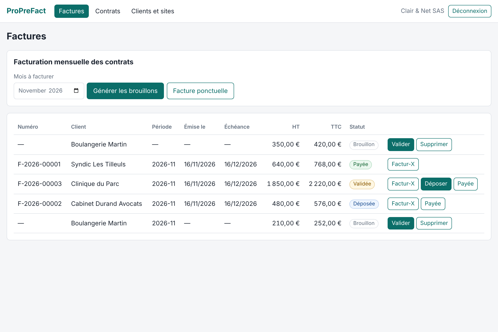

# ProPreFact

Facturation récurrente pour les entreprises de propreté, avec factures au format Factur-X
(facturation électronique obligatoire en France).



Exemple de facture produite : [docs/exemple-facture-facturx.pdf](docs/exemple-facture-facturx.pdf).

## Démarrer en développement

Prérequis : Java 21, Node 22, Docker.

```bash
docker compose up -d
```

```bash
cd backend && SPRING_PROFILES_ACTIVE=dev ./mvnw spring-boot:run
```

```bash
cd frontend && npm install && npm start
```

L'application est sur http://localhost:4200 (les appels `/api` sont relayés vers le port 8080).
À l'inscription, le lien de confirmation s'affiche dans le journal du back-end.

## Tests

```bash
cd backend && ./mvnw verify
cd frontend && npm run format:check && npm run lint && npm test
```

Les tests d'intégration démarrent une base PostgreSQL jetable : Docker doit être lancé.

Les tests d'intégration héritent de `TestIntegration` et sont rangés par sujet : `ComptesTest` (inscription,
confirmation, connexion), `FacturationTest` (des contrats au Factur-X), `DepotTest` (plateforme agréée) et
`CloisonnementTest` (séparation entre entreprises). Les tests unitaires du domaine utilisent les objets prêts à
l'emploi de `domain/Exemples`.

## Organisation

- `backend/` : Spring Boot 4, PostgreSQL, Flyway. Une seule base pour toutes les entreprises ;
  chaque ligne porte un `entreprise_id` que Hibernate filtre automatiquement (`TenantResolver`, `@TenantId`).
- `frontend/` : Angular 22. `auth/` (session, intercepteur, garde), `api/` (appels HTTP, types, messages d'erreur),
  `commun/` (pipes, notifications), `pages/` (un écran par fichier).
- `backend/src/main/java/com/proprefact/service/facturx/` : Factur-X, c'est-à-dire un PDF/A-3 lisible (`FacturePdf`)
  qui embarque le XML EN 16931 (`FactureXml`, bibliothèque Mustang).
- Une facture validée est figée : elle garde sa copie des coordonnées vendeur et acheteur, et le fichier
  Factur-X émis est conservé en base (`facture_document`) puis resservi à l'identique.
- `backend/src/main/java/com/proprefact/service/DepotService.java` : dépôt en trois temps (intention enregistrée,
  appel hors transaction, résultat enregistré), rejoué chaque minute avec la même clé d'idempotence tant qu'il échoue.
- `backend/src/main/java/com/proprefact/service/PlateformeAgreee.java` : point d'intégration de la
  plateforme agréée. L'implémentation actuelle est **simulée** et ne transmet rien.

## Conventions

- **Langue.** Le vocabulaire du métier est en français, sans accents dans les identifiants (`Facture`, `valider`,
  `dateEcheance`). Les suffixes techniques restent en anglais (`…Service`, `…Controller`, `…Repository`, `find…`).
  Commentaires, messages et commits sont en français.
- **Dépendances entre paquets du back-end.** `web → service → domain`, `service → repo → domain`,
  `config → service`. `service` n'importe jamais `web` ; `domain` n'importe aucun autre paquet du projet ;
  un contrôleur n'appelle jamais un dépôt et ne porte pas `@Transactional`.
- **Règles métier.** Elles vivent dans les entités (`Facture.valider`, `Contrat.terminerLe`…), pas dans les
  contrôleurs. Aucune entité n'a de setters. Les services lancent des exceptions du paquet `domain`,
  que `web/ErreursApi` traduit en réponses HTTP.
- **Migrations.** Un fichier `V…sql` déjà fusionné ne se modifie jamais : tout changement de schéma est un
  nouveau fichier. Chaque contrainte porte un nom.
- **Front-end.** Formulaires réactifs typés ; aucun `error:` dans les `subscribe` des écrans, l'intercepteur
  affiche les erreurs ; pas de style dans les gabarits.
- **Avant de commiter.** `./mvnw spotless:apply` puis `./mvnw verify` dans `backend/` ;
  `npm run format`, `npm run lint`, `npm test` dans `frontend/`.
- **Polices.** Les polices DejaVu incorporées aux PDF sont distribuées avec leur licence
  (`backend/src/main/resources/fonts/LICENSE-DejaVu.txt`).

Le détail des corrections issues de la revue de qualité est dans `DIRECTIVES_CORRECTIONS.md`, et leur état
dans `AVANCEMENT.md`.

## Déploiement

Le dossier `deploiement/` lance l'application complète avec Docker : une base PostgreSQL, le back-end, et nginx
qui sert le front-end et relaie `/api`. Seul nginx est exposé ; la base et le back-end ne sont joignables
qu'entre conteneurs.

```bash
cp deploiement/.env.exemple deploiement/.env   # puis remplir chaque valeur (secrets : jamais commités)
./deploiement/construire.sh                     # tests, compilation, puis images Docker
docker compose -f deploiement/docker-compose.yml up -d
```

- Les images embarquent le jar et le front déjà compilés : `construire.sh` les produit avec les outils du
  projet (tests compris) avant de construire les images, qui ne téléchargent rien.
- Les données sont dans le volume Docker `proprefact-production_donnees`. Le sauvegarder, par exemple :
  `docker compose -f deploiement/docker-compose.yml exec -T db pg_dump -U proprefact proprefact > sauvegarde.sql`.
- HTTPS n'est pas géré ici : placer devant nginx le proxy HTTPS de l'hébergeur (ou Caddy, Traefik…). Dans ce
  cas, lire le commentaire de `frontend/nginx.conf` sur l'adresse IP réelle du client.
- Mise à jour : relancer `construire.sh` puis la commande `up -d` ; les migrations Flyway s'appliquent au
  démarrage du back-end.

## Configuration de production

| Variable | Rôle |
|---|---|
| `DB_URL`, `DB_USER`, `DB_PASSWORD` | Connexion PostgreSQL |
| `JWT_SECRET` | Secret de signature des jetons, 32 caractères minimum, obligatoire |
| `APP_URL` | Adresse publique du front-end, utilisée dans les liens envoyés par e-mail |
| `MAIL_HOST`, `MAIL_PORT`, `MAIL_USER`, `MAIL_PASSWORD`, `MAIL_EXPEDITEUR` | Serveur SMTP d'envoi des e-mails |
| `FORWARD_HEADERS` | `framework` derrière un proxy inverse, pour limiter les tentatives sur la vraie adresse IP |

Sans `MAIL_HOST`, les e-mails (dont les liens de confirmation) sont seulement écrits dans le journal :
pratique en développement, à ne jamais laisser en production.

Ne pas activer le profil `dev` en production : il contient un secret connu.

## Reste à faire avant de vendre

- Brancher une vraie plateforme agréée (dépôt, statuts, réception des factures fournisseurs).
- Faire valider les mentions et le XML par cette plateforme (catégorie de l'opération, adresse électronique).
- Avoirs, modification des brouillons, prorata des mois incomplets, factures de plus d'une page.
- Devis, relances de paiement, export comptable, abonnements Stripe.
- Réinitialisation du mot de passe, plusieurs utilisateurs par entreprise.
- Limites de tentatives partagées entre instances (elles sont aujourd'hui en mémoire, par instance).
